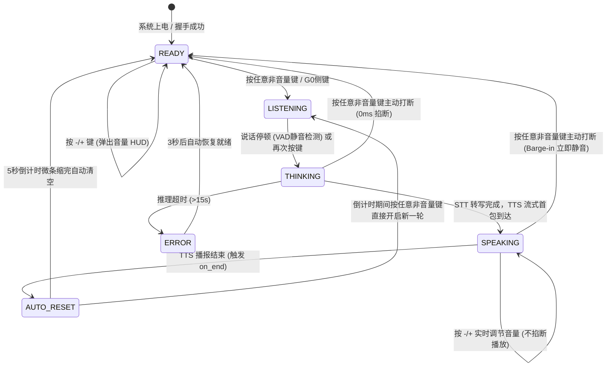

# 系统技术架构与交互状态机

本文档详细描述了 Cardputer 离线语音对讲终端与家庭服务端之间的交互状态机与通信链路。

---

## 1. 系统全景架构

```mermaid
flowchart TD
    subgraph CardputerAdv ["M5Stack Cardputer-Adv (ESP32-S3)"]
        MIC["I2S MEMS 麦克风 (GPIO46)"]
        SPK["ES8311 DAC + NS4150B 扬声器 (GPIO42)"]
        DISP["ST7789V 屏幕 (135x240)"]
        KEY["TCA8418 键盘控制器 (I2C 0x34)"]
        ESPCore["ESPHome Voice Assistant Core"]
        
        MIC -->|16kHz 16bit PCM| ESPCore
        ESPCore -->|I2S DMA Audio| SPK
        ESPCore -->|UI State & 波形| DISP
        KEY -->|Raw Key Events| ESPCore
    end

    subgraph HomeServer ["局域网家庭服务器 (Host Network)"]
        HA["Home Assistant Core (Port 8123)"]
        WHISPER["Faster-Whisper STT (Port 10300)"]
        PIPER["Wyoming-Piper TTS (Port 10200)"]
        GATEWAY["AI Legion Gateway (Port 8096)"]
        OLLAMA["Local LLM (Phi-4-mini)"]
        
        ESPCore <==>|ESPHome Native API (TCP 6053)| HA
        HA <-->|Wyoming Protocol| WHISPER
        HA <-->|Wyoming Protocol| PIPER
        HA <-->|Ollama Chat API| GATEWAY
        GATEWAY <-->|Ollama API| OLLAMA
        GATEWAY -->|REST API 物理设备动作| HA
    end
```

---

## 2. 状态机流转设计 (State Machine)

设备生命周期由 5 个核心状态组成，具备严密的超时自动回收与无死角打断机制：



---

## 3. 核心交互机制详解

### 3.1 真实物理麦克风波形计算 (`visualizer.h`)
在录音期间，ESPHome 将从 I2S 麦克风接收到的真实 PCM 音频块送入 `visualizer::on_mic_data()`：
- 采用短时 RMS（均方根）能量估算；
- 通过一阶 IIR 低通滤波器（阻尼系数 0.45）实现平滑衰减，避免瞬态跳变；
- 在屏幕中央渲染 18 根对称音频能量柱，能量达到阈值时自动点缀亮绿峰值点。

### 3.2 0 毫秒按键主动打断 (Barge-in)
无论在思考中（State 2）还是播放中（State 3）：
- 用户按下任意非音量按键，底层在 0 毫秒内同步调用 `id(echo_speaker)->stop()`，彻底释放 I2S DMA 发送队列并静音；
- 同时清空文本缓冲，重置状态为 `va_state = 0`，屏幕在下一渲染周期立即切回干净的待命卡片。

### 3.3 5 秒自动超时重置 (Auto-Reset)
为解决“对讲结束后对话卡片永久滞留无法恢复就绪”的体验问题：
- 在 `on_end` 回调中设置 `dialog_reset_timeout_ms = millis() + 5000`；
- 在待命渲染中显示对话气泡卡片，下方绘制一条逐渐缩短的青色进度条；
- 5 秒一到，系统自动清空历史文本，平滑回归待命主卡片。
